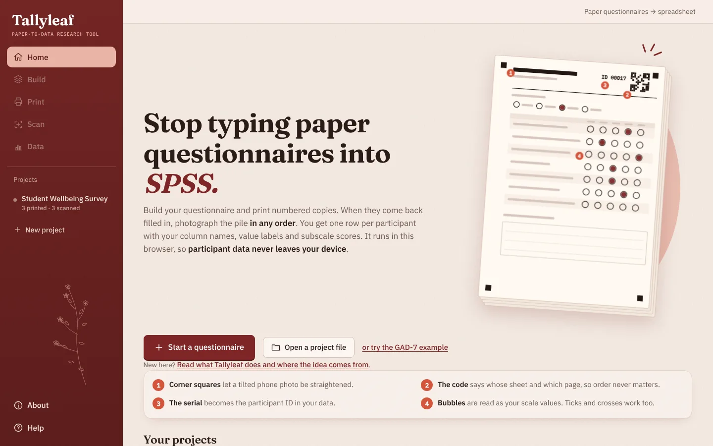
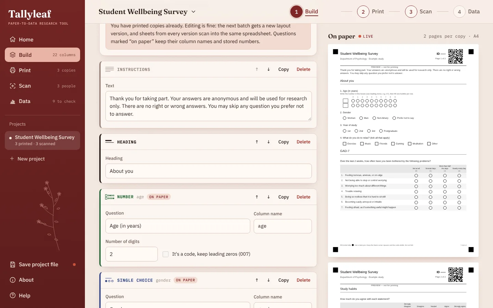
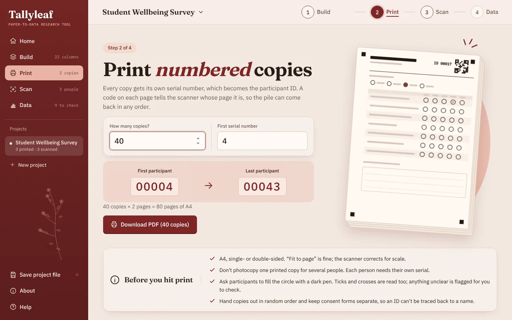
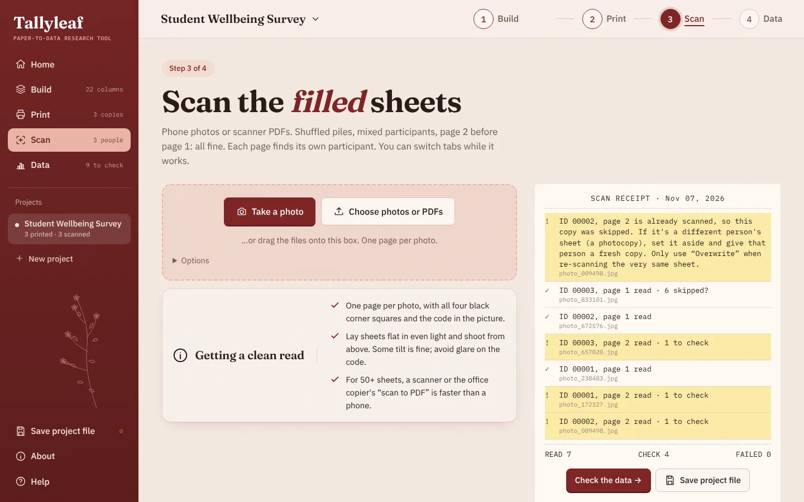
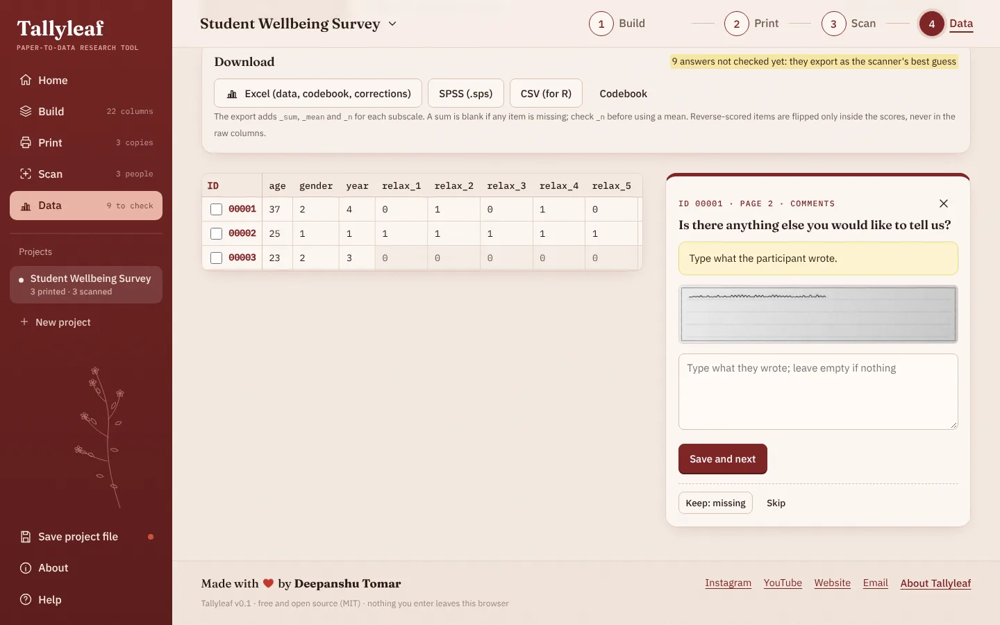
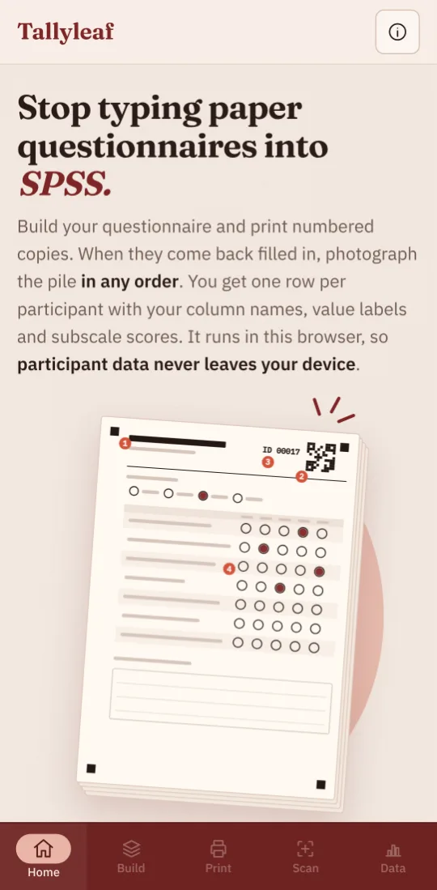
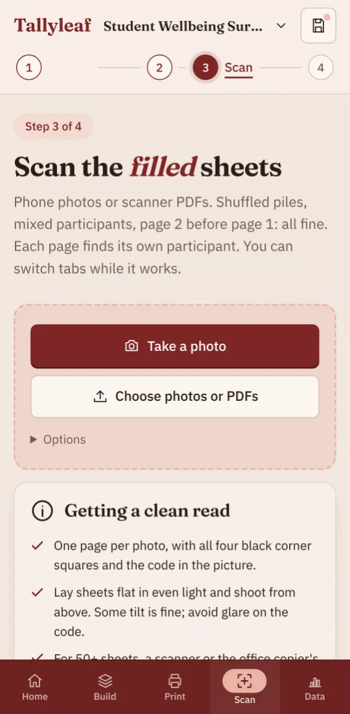
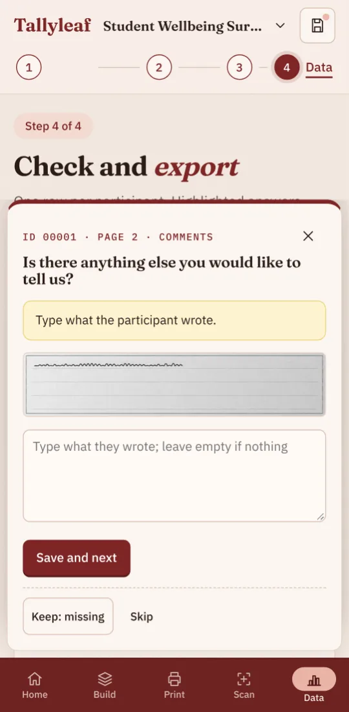
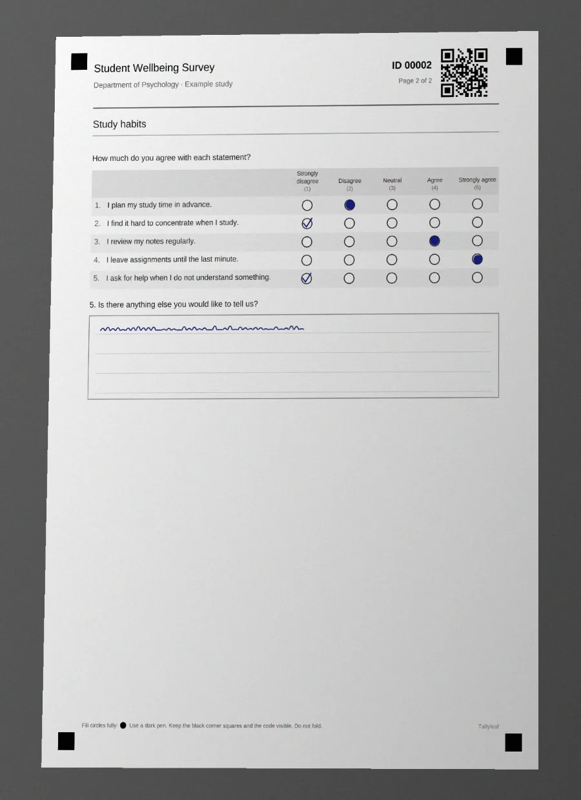

# Tallyleaf

**A paper-to-data research tool.** Build a questionnaire, print numbered copies, photograph the filled pile in any order, and get a spreadsheet with your column names, value labels and subscale scores. It runs entirely in the browser: no account, no server, and participant data never leaves the device.

Made for psychology students who have spent a weekend typing questionnaires into SPSS.



## What it does

1. **Build**: rating scales (Likert grids), single choice, tick-all-that-apply, numbers/codes (digit bubbles), open answers, headings, instructions and page breaks. Each question gets a column name, stored values, reverse-scoring and a subscale. A live preview shows the real printed pages.
2. **Print**: an A4 PDF of numbered copies. Every page carries four corner squares, a QR code (project, layout version, participant ID, page) and the ID in print. IDs continue across batches; teammates can reserve their own ID ranges.
3. **Scan**: phone photos or scanner PDFs, shuffled, mixed participants, any page order. Each page is straightened, matched to its participant and read. Faint, doubled or skipped marks are flagged with a picture of the original.
4. **Data**: check flagged answers, then export Excel (data, codebook, corrections log), a self-contained SPSS syntax file with every label, or CSV for R.

## Screenshots

**1 · Build**: blocks in paper order, with a live preview of the printed pages.



**2 · Print**: numbered copies; IDs continue from the last batch.



**3 · Scan**: drop shuffled photos; each page finds its participant. Duplicates and blank printouts are caught.



**4 · Data**: check flagged answers next to a picture of the original, then export.



**On a phone**: the whole flow works without a computer.

<p>
  
  &nbsp;
  
  &nbsp;
  
</p>

**What the scanner sees**: a tilted, unevenly lit phone photo of a filled sheet (simulated) that is read correctly.



## How to use it

You only need a browser. Chrome, Edge, Safari and Firefox all work, on a laptop or a phone.

### 1. Build your questionnaire
1. Open Tallyleaf and click **Start a questionnaire**, or **try the GAD-7 example** to see a finished one.
2. Give it a title, then add blocks in the order they should appear on paper:
   - **Rating scale** for Likert-type items. Pick a preset (Agreement 1–5, Frequency 0–3, …) or type your own scale points and the number each one is stored as. Paste a whole published scale at once with *Paste a whole scale*, one statement per line.
   - **Single choice**, **Tick all that apply**, **Number** (age, participant code: tick *keep leading zeros* for codes like 007), **Open answer**, **Heading**, **Instructions** and **Page break**.
3. Every question gets a **column name** (e.g. `gad1`, `age`). That is the column header in your spreadsheet. Mark **reverse-scored** items and give items a **subscale** name to get `_sum`, `_mean` and `_n` scores in the export.
4. Watch the **preview** on the right (below, on a phone). It shows exactly what will be printed.

### 2. Print numbered copies
1. Go to **Print**, choose how many copies, and download the PDF. Each copy has its own ID (00001, 00002, …), which becomes the participant ID.
2. Print on A4. Single- or double-sided is fine, and so is "fit to page".
3. **Don't photocopy** a printed copy for several people: two sheets with the same ID would be treated as one person. Need more? Print another batch; the IDs continue where you stopped.
4. Working with teammates? Under *Printing with teammates?* reserve an ID range for each person, then send them the project file.
5. Ask participants to **fill the circles with a dark pen**. Ticks and crosses are read too; anything unclear is flagged for you.

### 3. Scan the filled sheets
1. Go to **Scan** and tap **Take a photo** (phone) or **Choose photos or PDFs** (photos from a phone, or a PDF from a scanner or office copier).
2. One page per photo, with all four black corner squares and the code (top right) visible. Order doesn't matter, and neither do mixed participants or page 2 before page 1.
3. The receipt lists every page: ✓ read, ! needs a look, ✕ couldn't be read (with the reason, e.g. "the bottom-left corner square isn't visible").
4. Made a mistake? **Undo this session** removes everything from the last batch of photos.

### 4. Check and export
1. Go to **Data** and click **Check flagged answers**. For each one you see a picture of the original and choose the right answer. Handwritten answers are typed in here.
2. **Confirm skipped as missing** clears all "nothing marked" flags at once.
3. Download:
   - **Excel**: data, codebook and a log of every manual correction.
   - **SPSS (.sps)**: open in SPSS or PSPP and choose *Run → All*. The data and all variable and value labels are inside the file.
   - **CSV** for R: `read.csv("my-study.csv")`.

### Keep your project file
Your work is saved in the browser automatically, but browsers can clear their storage. Use **Save project file** (sidebar, or the save icon on a phone) to download a `.tallyleaf` file:
- Open it on any device (home screen → *Open a project file*) to keep working or to scan there.
- A teammate can scan the other half of the pile and send you their file; use **Merge a teammate's file** in Data.
- It contains participants' answers and pictures of their handwriting, so store and share it like research data.
- Lost it? Opening any PDF Tallyleaf generated restores the questions and print history (not the scanned answers).

## Install and run on your own computer

You only need this to run your own copy or to work on the code. Everyone else can use the hosted website.

### What you need
- **Node.js 22 LTS** (20.19 or newer also works). It includes `npm`.
- The project folder: download the zip and unpack it, or `git clone` the repository.

### macOS
1. Install Node.js: download the **LTS** installer from [nodejs.org](https://nodejs.org) and run it. If you use Homebrew, `brew install node@22` works too.
2. Open **Terminal** (Spotlight → "Terminal") and go to the project folder, for example:
   ```bash
   cd ~/Downloads/tallyleaf
   ```
3. Install the dependencies (first time only, takes a minute):
   ```bash
   npm install
   ```
4. Start it:
   ```bash
   npm run dev
   ```
5. Open the address it prints (usually **http://localhost:5173**) in your browser. Press `Ctrl + C` in Terminal to stop.

### Windows
1. Install Node.js: download the **LTS** installer (`.msi`) from [nodejs.org](https://nodejs.org) and run it with the default options. Or in PowerShell: `winget install OpenJS.NodeJS.LTS`.
2. Open **PowerShell** (Start menu → "PowerShell") and go to the project folder, for example:
   ```powershell
   cd $HOME\Downloads\tallyleaf
   ```
3. Install the dependencies (first time only):
   ```powershell
   npm install
   ```
   If PowerShell says *running scripts is disabled*, use **Command Prompt** (`cmd`) instead, or run `Set-ExecutionPolicy -Scope CurrentUser RemoteSigned` once.
4. Start it:
   ```powershell
   npm run dev
   ```
5. Open **http://localhost:5173** in your browser. Press `Ctrl + C` to stop.

### Other commands
```bash
npm run build      # makes a static website in dist/
npm run preview    # serves dist/ locally to check the build
npm test           # unit and end-to-end tests
```
Opening `dist/index.html` by double-clicking won't work (browsers block the scanner's background worker on `file://`). Serve it with `npm run preview` or any web server.

## Put it online for free (GitHub Pages)

The repository includes `.github/workflows/deploy.yml`, which builds the site and publishes it on every push to `main`.

1. Upload the project to a GitHub repository (see below).
2. In the repository, open **Settings → Pages** and set **Source** to **GitHub Actions**.
3. Open the **Actions** tab and wait for *Deploy to GitHub Pages* to turn green (about a minute). If it ran before Pages was enabled, click *Re-run all jobs*.
4. Your site is at `https://<your-username>.github.io/<repository-name>/`. Share that link with students.

### Uploading the zip without the command line
1. Create an empty repository at [github.com/new](https://github.com/new) (don't add a README, .gitignore or license).
2. Unzip `tallyleaf.zip`.
3. On the new repository's page, click **uploading an existing file** and drag **everything inside** the `tallyleaf` folder into the browser.
   - **Mac:** Finder hides files that start with a dot. Press `Cmd + Shift + .` in Finder first so `.github` and `.gitignore` are visible and get uploaded.
   - **Windows:** in File Explorer, turn on *View → Show → Hidden items*.
   - Don't upload a `node_modules` folder if you have one; it is recreated by `npm install`.
4. Click **Commit changes**, then follow the GitHub Pages steps above.

The [GitHub Desktop](https://desktop.github.com) app is an easier alternative: *File → Add local repository*, choose the folder, then *Publish repository*.

## How the scanning works

- The QR code says which project, layout version, participant and page a sheet is, so order never matters.
- The four corner squares give a perspective transform (homography) from the printed page to the photo. Alignment is accepted only if the printed bubble outlines line up where expected, so a misaligned photo fails loudly instead of giving wrong answers.
- Each bubble is scored by the darkness of its centre and the amount of ink inside it, relative to the paper around it. That handles filled circles, ticks, crosses, pencil and coloured pens.
- Bubble positions are stored in the project file when you print, so the scanner never has to guess the layout.

## The project file

`.tallyleaf` files hold the questions, every printed batch and every scanned answer (including pictures of handwriting, so store them like research data). Send it to a teammate to scan the other half of the pile, then merge. Every generated PDF also embeds the questions and print history, so a lost project file can be recovered from any printed PDF.

## Known limits

- Tested on simulated photos only so far; a field validation on real sheets is planned.
- The PDF font covers Latin characters; Hindi and other scripts are planned.
- Handwriting is not read automatically; you type open answers while looking at the picture.

## Contributing

Issues and pull requests are welcome. Please run `npm test` before submitting.

## License

MIT © Deepanshu Tomar. Made with ♥ · [Instagram](https://www.instagram.com/deepanshutomarg) · [YouTube](https://www.youtube.com/@DeepanshuTomarJi) · [deepanshutomar.in](https://deepanshutomar.in)
